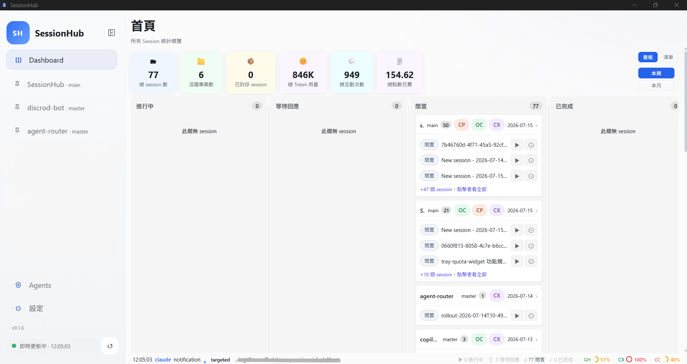
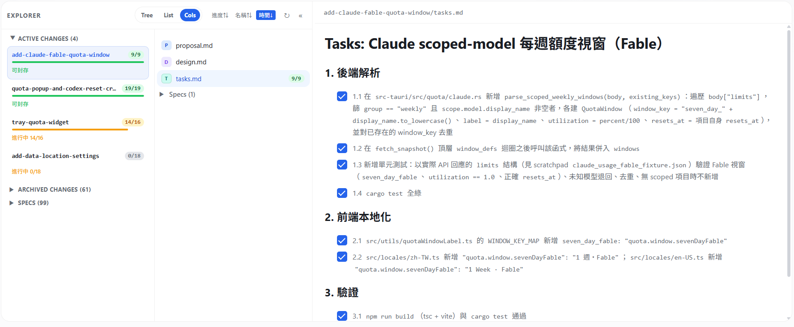
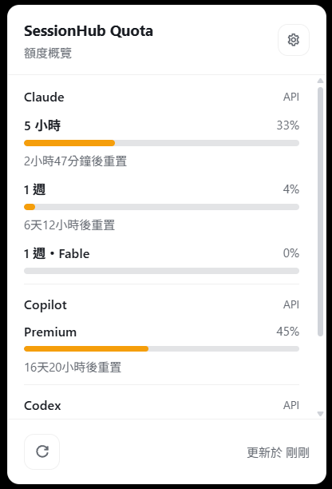
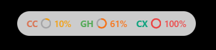
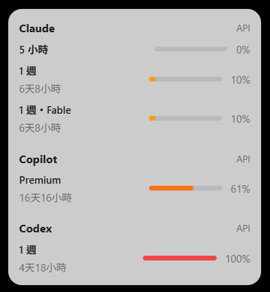

# SessionHub

> A desktop workspace for AI coding sessions on Windows: manage sessions, quotas, Plans & Specs, Agents, and MCP settings across multiple CLI providers.

[繁體中文](README.md) | English

<p>
  <a href="https://github.com/chingleel17/SessionHub/actions/workflows/ci.yml"></a>
  <a href="https://github.com/chingleel17/SessionHub/releases"></a>
  
  
  
</p>

SessionHub is for developers who use GitHub Copilot CLI, OpenCode, Codex, Claude Code, or Antigravity. It brings sessions scattered across these tools into one place, so you can find your context, return to a terminal, and keep track of model quotas.

## Features

- **Sessions across providers**: Scan sessions from five AI coding tools and see their projects, branches, summaries, and last update times.
- **Project tabs and search**: Group sessions by working directory; search, tag, pin, and sort them.
- **Dashboard and statistics**: Track session status on a board alongside token usage, interaction counts, and spending trends.
- **Quota monitoring**: Check usage, remaining quota, and reset times by provider and model group.
- **Tray and overlay**: Check quotas from the system tray; choose between compact and detailed overlay views.
- **Plans & Specs**: Browse OpenSpec changes, specs, tasks, and `.sisyphus` plans.
- **Agents and MCP management**: Inspect sync status and manage Agents, Skills, Commands, and MCP servers through the GUI.
- **Hooks and live updates**: Use provider hooks to refresh sessions automatically and receive notifications when they change.
- **Session actions**: Open a terminal, copy a resume command, edit `plan.md`, add notes and tags, or archive a session.
- **Chinese and English UI**: Switch between Traditional Chinese and English.

## Supported Providers

| Provider | Session data source | Quota support |
| --- | --- | --- |
| GitHub Copilot CLI | `~/.copilot/session-state/` | Status and quota integration |
| OpenCode | session/message/part data directories | Session statistics |
| Codex | Codex data directory | Quota and reset credits |
| Claude Code | `~/.claude/` | API quota |
| Antigravity (Google Gemini) | `~/.gemini/` brain roots | Local language server RPC quota |

You can enable or disable each provider and set its data root in Settings. Available quota details depend on the provider version, sign-in status, and local environment.

## Screenshots

### Dashboard

See session counts, active projects, token usage, interaction counts, and spending in one place, and browse each project's sessions on a board.



### Plans & Specs

Browse active and archived OpenSpec changes, specs, and task progress within a project using Tree, List, or Cols views.



### Tray quota panel

When SessionHub is minimized to the system tray, click its tray icon to see quota usage, reset times, and update status for providers such as Claude, Copilot, and Codex.



### Quota overlay

The overlay comes in two sizes: a compact view for quick checks and a full view with provider-grouped quota windows, progress bars, and reset times.





## Installation

### Use an installer

1. Download the latest `.msi` or `-setup.exe` from [Releases](../../releases).
2. Run the installer and follow its setup wizard.
3. Launch SessionHub from the Start menu or desktop shortcut.

### Build from source

Requirements: Windows 10/11 x64, stable Rust, Node.js 22+, Bun, and at least one supported AI coding tool.

```bash
bun install
bun run tauri dev
```

To build an installer:

```bash
bun run tauri build
```

Output is written to `src-tauri/target/release/bundle/`.

### macOS build (experimental)

macOS icon styles and native widgets require the full Xcode installation (Command Line Tools alone are not enough):

```bash
# Check that actool is available; a failure means Xcode is not the active developer directory
xcrun --find actool

# Option 1: Change the system default (requires sudo)
sudo xcode-select -s /Applications/Xcode.app/Contents/Developer
# Option 2: Apply only to this build
DEVELOPER_DIR=/Applications/Xcode.app/Contents/Developer bun run tauri build
```

- For one-step packaging, use `scripts/macos-package.sh` (add `--install` to replace the app in /Applications). It calls `scripts/macos-inject-icon.sh` to compile `src-tauri/icons/macos/AppIcon.icon` into `Assets.car`, set `CFBundleIconName`, and re-sign the app (ad-hoc by default; set `CODESIGN_IDENTITY` to use another identity).
- The macOS menu bar icon is a monochrome template image tinted by the system for light or dark mode; fill level, rather than color, indicates usage.
- Dock icon styles (dark, clear, and tinted) **only apply to the packaged `.app`**; the unsigned `bun run tauri dev` binary does not use them.
- The activity snapshot `activity-snapshot.json` is written to the App Group container (`~/Library/Group Containers/group.com.ching.sessionhub/`) when available, with the app data directory as a fallback.

## Quick Start

1. Open Settings, enable the providers you want to manage, and check their data roots.
2. Set the PowerShell/pwsh path and, if needed, an external editor.
3. Enable quota tracking, notifications, tray features, and hook integration as needed.
4. Return to the Dashboard to find or open a session from a project tab.
5. Click the tray icon to check quotas at any time; switch the overlay between compact and detailed views.

## Data and Privacy

SessionHub primarily reads local provider data. Settings and notes are stored under `%APPDATA%\SessionHub\`. Apart from quota queries required by the providers themselves, session content is not uploaded to a SessionHub-operated service; the project currently has no cloud backend of its own.

| Data | Path |
| --- | --- |
| App settings | `%APPDATA%\SessionHub\settings.json` |
| Notes, tags, and cache | `%APPDATA%\SessionHub\metadata.db` |
| GitHub Copilot CLI sessions | `~/.copilot/session-state/` |
| Claude Code sessions | `~/.claude/` |
| Antigravity sessions | `~/.gemini/` |

Do not post credentials, session content, or other sensitive information in issues, screenshots, or pull requests.

## Tech Stack

- Frontend: React 19, TypeScript, Vite, React Query
- Desktop framework: Tauri 2
- Backend: Rust
- Storage: SQLite (bundled rusqlite)
- Live monitoring: `notify` filesystem watcher and provider hook bridge
- UI: plain CSS, theme tokens, and responsive layout

## Development and Verification

```bash
# Frontend type check and build
bun run build

# Rust formatting, linting, and unit tests
cd src-tauri
cargo fmt -- --check
cargo clippy --all-targets --all-features -- -D warnings
cargo test
```

## Contributing and Reporting Issues

Technical discussion, bug reports, and feature suggestions are welcome. See [CONTRIBUTING.md](CONTRIBUTING.md) for development and contribution guidelines.

- Bugs or feature requests: open a GitHub [issue](../../issues/new/choose).
- Security vulnerabilities: follow [SECURITY.md](SECURITY.md) to report privately rather than posting a public issue.

## License

This project is licensed under the [MIT License](LICENSE). Third-party providers, CLIs, and icon assets remain subject to their respective licenses.

## Changelog

See [CHANGELOG.md](CHANGELOG.md).
